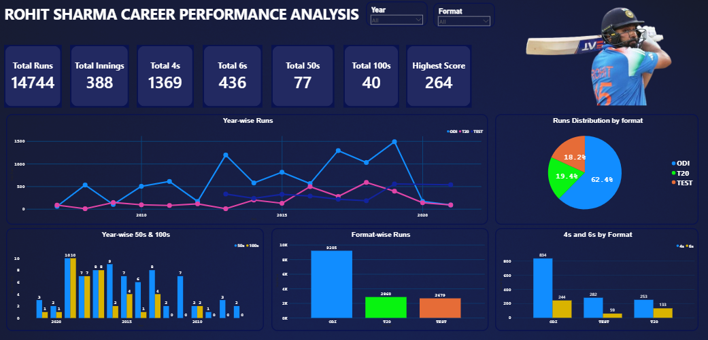

# Rohit Sharma Career Performance Analysis

Power BI dashboard analysing Rohit Sharma's career across ODI, T20 and Test formats.

## Key Insights
- 14,744 total runs in 388 innings
- 40 centuries, 77 fifties, highest score 264
- ODI contributes 62.4% of total runs
- 1,369 fours and 436 sixes

## Dashboard Preview

## Tools Used
- Power BI
- DAX
- Data Visualization
